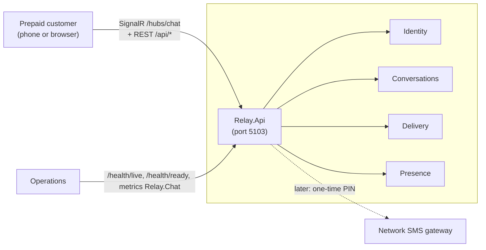

# Architecture

## Style and why
Modular monolith on ASP.NET Core SignalR (ADR-0001). Advisor output for launch traits (MillionsOfLiveConnections, PersonalData, SmallTeam): **ModularMonolith**; a small team can't run microservices, and strict modules let the hot part be extracted later. At global scale the advisor's answer is **Microservices**. Evolution trigger: split Delivery and Presence into their own scaled services when one region passes ~200k concurrent connections.
Full comparison, capacity sums and diagrams: `docs/DESIGN.md`. Decision record: `decisions/0001-architecture-style.md`.

## Context

## Modules and boundaries
| Module (project) | Owns | Public contract | May call |
|---|---|---|---|
| Identity (`src/Modules/Identity`) | users, devices, demo sessions (token hashes only) | `IIdentity` | nothing |
| Conversations (`src/Modules/Conversations`) | conversations, message metadata, sequence numbers, receipts and the tick state machine (sent → delivered → read), idempotency on client message ID | `IConversations` | nothing |
| Delivery (`src/Modules/Delivery`) | encrypted message bodies (AES-GCM) held per message, one ordered queue per device, deletion on last ack, 30-day retention | `IDelivery`, `DeliveryOptions` | nothing |
| Presence (`src/Modules/Presence`) | live connections per user/device, last seen | `IPresence` | nothing |
| API (`src/Relay.Api`) | composition root: `ChatHub` (`/hubs/chat`), REST endpoints, demo token auth, `ChatCoordinator` (the only code that combines modules), `RetentionSweeper`, health checks, demo seed | n/a | every module's Contracts |

Rules (enforced by `tests/Relay.Tests/Architecture/ModuleBoundaryTests.cs`): modules have no project references to each other; only `Relay.<Module>.Contracts` types and the `<Module>Module` registration class are public; internals are visible only to `Relay.Tests`.

Storage: thread-safe in-memory repositories behind ports (`IConversationRepository`, `IDeliveryStore`); Postgres with one schema per module in slice 2.

## Hub contract (`/hubs/chat`)
- Client → server: `Send({conversationId, clientMessageId, body}) → {ok, error, messageId, seq, sentAt, status, duplicate}`, `SyncPending() → Envelope[]`, `AckDelivered(messageIds[]) → int`, `MarkRead(conversationId, upToSeq) → int`.
- Server → client: `MessageReceived(envelope)`, `TickUpdated({conversationId, messageId, status, at})`, `PresenceChanged({userId, online, lastSeenAt})`.
- Groups: `device:<deviceId>` (message pushes), `user:<userId>` (ticks, presence).

## Cross-cutting
- **Auth:** `DemoToken` bearer scheme (Development-only sessions from `POST /api/identity/demo-sessions`); the hub reads `access_token` from the query string.
- **Errors:** ProblemDetails for every 4xx/5xx; hub sends return `{ok:false, error:"<code>"}`; `EnableDetailedErrors` off.
- **Logging:** structured, IDs and counts only (source-generated `LoggerMessage`); SignalR transport categories pinned at Warning so hub arguments never reach logs. A test proves message bodies never appear in logs.
- **Time:** `TimeProvider` everywhere (tests use a manual clock).
- **Config:** `Delivery:ContentKey` (base64 AES key, validated on start; ephemeral in Development), `Delivery:Retention`, `Delivery:MaxBodyLength`. See `.env.example`.
- **Metrics:** meter `Relay.Chat` (`relay.messages.accepted`, `relay.messages.duplicate_sends`, `relay.delivery.latency`).
