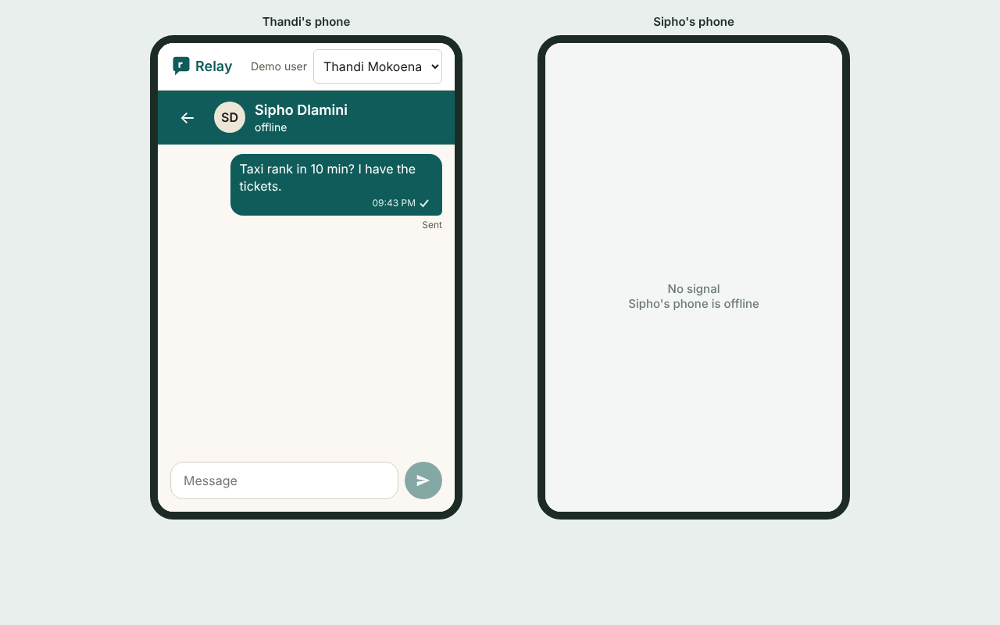
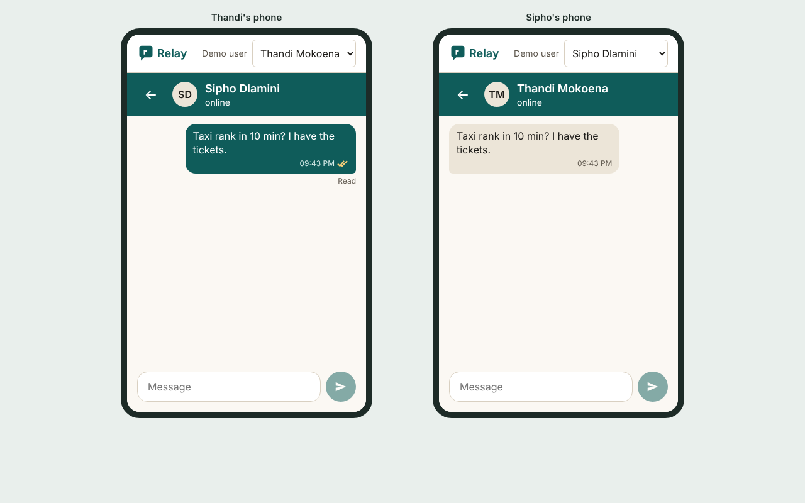
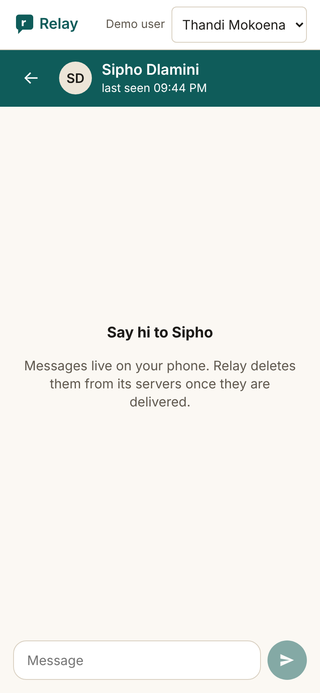
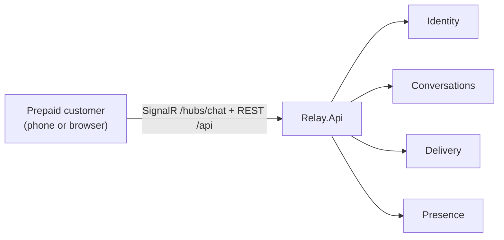

# Relay

A private messaging app for Kalahari Mobile's prepaid customers (fictional client). The network's customers rely on foreign messaging apps that don't work on zero-rated data, so customers with no airtime can't message at all. Relay is built for low-end phones on patchy 2G/3G networks.

## See it in action


| Sent (recipient offline) | Read | Mobile |
|---|---|---|
|  |  |  |

Full-quality video: [docs/media/demo.mp4](docs/media/demo.mp4). Recorded from the running app with `demo/` (`cd demo && npm install && npm run record`); the scenario shows two phone-sized frames of the real web app, each signed in as a different demo user. At the delivered step it reads `/api/delivery/stats` and fails unless the server holds 0 message bodies.

## Design at a glance
**Brief.** One-to-one chat that delivers in under a second when both phones are online, loses nothing when a phone drops off the network, and forgets message content on the server as soon as it is delivered.

**Architecture.** A modular monolith on ASP.NET Core SignalR: one deployable with four strict modules (Identity, Conversations, Delivery, Presence) that talk only through public contracts, enforced by architecture tests. The architecture advisor recommends this for the launch profile (millions of live connections eventually, personal data, a four-person team), because a small team can't run microservices well. The module boundaries match the services the advisor recommends at global scale, so Delivery and Presence can be split out when one region passes ~200k concurrent connections. Full reasoning, capacity sums, flows and failure modes: [`docs/DESIGN.md`](docs/DESIGN.md).




## Run it in GitHub Codespaces

[](https://codespaces.new/Legion91919/relay?quickstart=1)

The dev container installs the SDKs, restores packages and runs every test once on first start. The same setup works locally with VS Code's Dev Containers extension.

| What | Command | Port |
|---|---|---|
| API (Relay) | `ASPNETCORE_ENVIRONMENT=Development ASPNETCORE_URLS=http://0.0.0.0:5103 dotnet run --project src/Relay.Api` | 5103 |
| Web app | `cd web && npm run dev` | 5173 |
| All tests (same as CI) | `scripts/test-all.sh` | - |

## What it does (slice 1)
- Two people chat in real time over SignalR (`/hubs/chat`, WebSockets with long-polling fallback).
- Ticks: one tick when the server has it, two when the other phone has it, amber when it has been read. Status is also shown as text, never by colour alone.
- Offline-safe: messages wait in a per-device queue and arrive in order when the phone reconnects. The sender's phone keeps unsent messages in an outbox and retries with the same message ID, so nothing is sent twice.
- Privacy: bodies are encrypted at rest and deleted once every recipient device has them (or after 30 days); the server keeps only receipts metadata; no message content in logs.
- Web chat UI with a demo user switcher: two browser tabs can be two people.

## Run locally
```bash
dotnet run --project src/Relay.Api           # API on http://localhost:5103 (seeds invented demo users)
cd web && npm install && npm run dev         # UI on http://localhost:5173
```
Tests, configuration and operations: `.agentic/runbook.md`.

## How this project is organised
- `src/Relay.Api`: composition root (hub, REST endpoints, auth, health, demo seed).
- `src/Modules/<Identity|Conversations|Delivery|Presence>`: one project per module; only `Contracts` are public.
- `tests/Relay.Tests`: domain, application, HTTP and architecture tests.
- `web/`: React + Vite + TypeScript chat UI; `web/scripts/smoke-signalr.mjs` is the end-to-end hub smoke test.
- `.agentic/`: project knowledge (start with `.agentic/README.md`); `docs/DESIGN.md`: design dossier. AI agents read `AGENTS.md` first.

Built with the Baton model from the Agentic Engineering Kit: frame → map → decide → sketch → slice loop → pass the baton.
