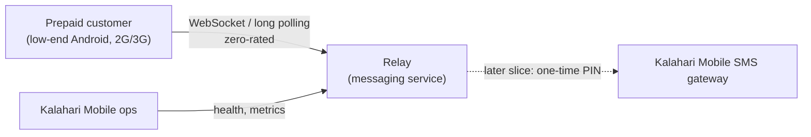
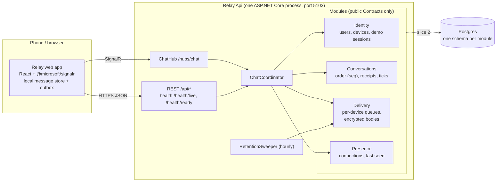
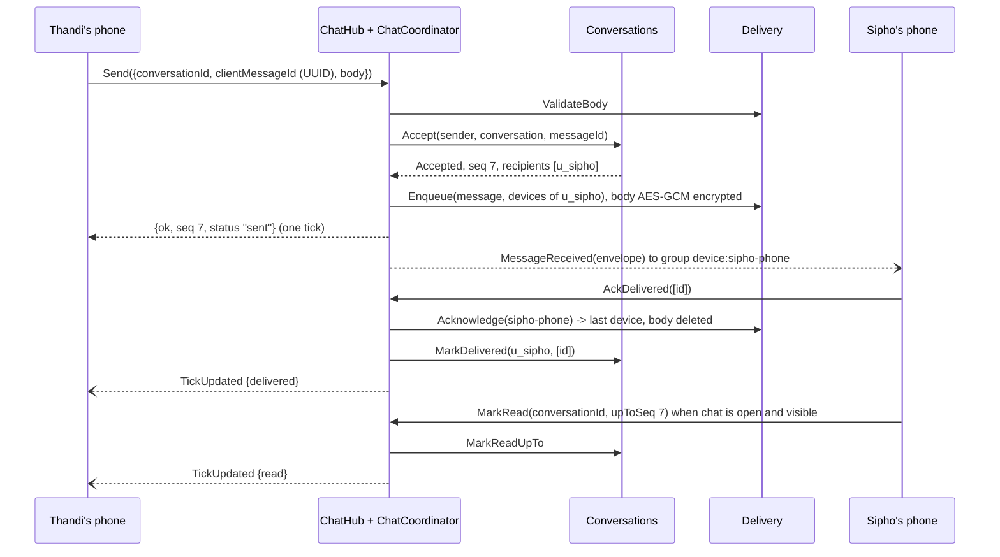
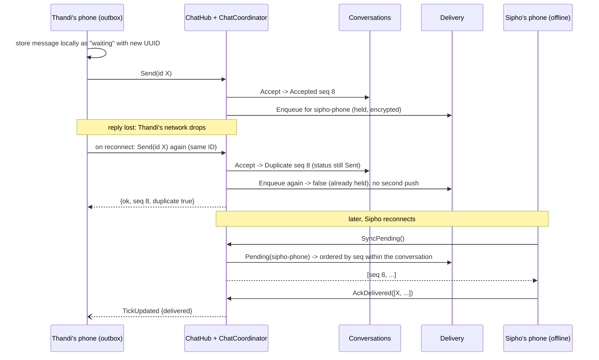
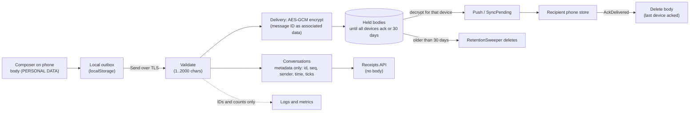
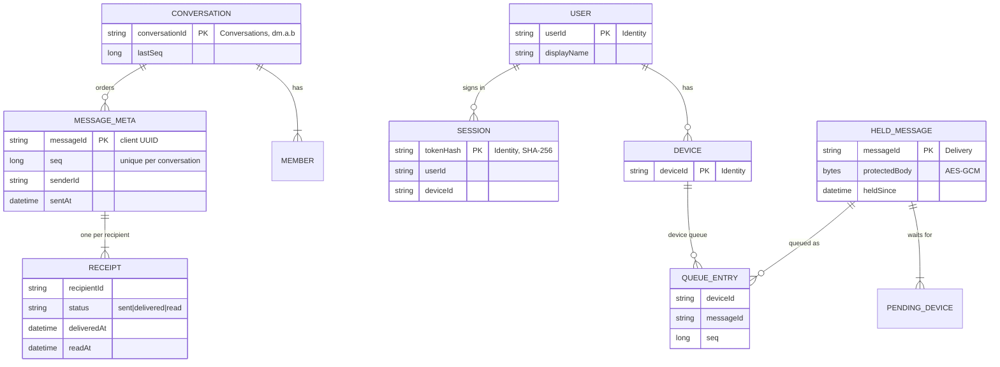

# Relay: design dossier

> Showcase project. Kalahari Mobile is a fictional client; every person, number and message here is invented.

## 1. Brief
- **Client:** Kalahari Mobile (fictional), a regional mobile network bundling messaging with its SIMs.
- **Problem:** customers rely on foreign messaging apps that don't work on zero-rated data, so customers with no airtime can't message at all.
- **Users:** prepaid customers on low-end Android phones and patchy 2G/3G networks, all day.
- **Outcomes:** delivered in under 1 second when both phones are online; nothing lost when a phone drops off the network; works on 2G.

## 2. Requirements
**Functional (slice 1, done):** two users exchange one-to-one messages in real time; ticks go sent → delivered → read; a phone that reconnects gets what it missed, in order; a retried send never creates a second message.

**Next slices:** Postgres persistence behind the same repository interfaces (slice 2); real sign-in by SMS one-time PIN; group chats (the tick model already takes the lowest status across recipients).

| Non-functional | Target | Source |
|---|---|---|
| Delivery latency (both online) | p95 < 1 s send → recipient | product.md outcome |
| Message loss | 0 accepted messages lost while retention lasts | product.md outcome |
| Availability | 99.9% of hub connections and sends over 30 days | quality.md |
| Data retention | body deleted once every recipient device acked; undelivered bodies deleted after 30 days | product.md constraint |
| Privacy | bodies encrypted at rest; no content in logs; receipts hold no content | product.md constraint |
| Network | usable on 2G: small JSON frames, WebSockets with long-polling fallback, no web fonts or images | product.md outcome |

## 3. Capacity estimate
Assumptions (rounded generously): pilot of **20,000** users (ADR-0001); 40% active per day; an active user sends 40 messages a day over 16 waking hours; 30% of users hold a connection at the evening peak; peak traffic is 5x the daily average.

| Quantity | Sum | Result |
|---|---|---|
| Messages per day | 20,000 × 0.4 × 40 | ~320,000 |
| Average send rate | 320,000 / 57,600 s | ~6 / s |
| Peak send rate | 6 × 5 | **~30 / s** (each send also causes 1 ack and 2 tick pushes: ~120 hub frames / s) |
| Peak live connections | 20,000 × 0.3 | **~6,000** |
| Keep-alive pings | 6,000 / 20 s | 300 / s, ~20 bytes each |
| Bodies held at any time | 10% of users offline with ~20 queued messages × ~600 bytes | ~25 MB |
| Receipts metadata per year | 320,000 × 365 × ~120 bytes | ~14 GB / year (pilot) |
| Peak bandwidth | 30 / s × ~1.2 KB (envelope + ack + ticks) | ~40 KB / s plus keep-alives |
| Connection memory | 6,000 × ~20 KB (assumed per SignalR connection) | ~120 MB, one node is plenty |

At the ADR's evolution trigger (**~200,000 concurrent connections in one region**) connection memory alone is ~4 GB and keep-alives ~10,000 / s, so the connection layer needs its own scaled tier: that is where the design splits (section 9).

## 4. Options considered
`arch-advisor compare MillionsOfLiveConnections PersonalData SmallTeam` (launch traits):

| Option | Fit | Complexity (1-5) | Main reason |
|---|---|---|---|
| Modular monolith | Recommended | 3 | Matches the advisor's recommended style (ModularMonolith). |
| Modular monolith + CQRS read models | Good alternative | 3 | Same family as the recommendation (ModularMonolith); a valid variant if its trade-offs suit the team. |
| Static site + serverless function | Poor fit | 1 | The product has real server-side behaviour and data; a static site can't hold it. |
| Layered monolith | Poor fit | 1 | Can't scale the hot part independently, and has no seams to extract it later. |
| Vertical slice monolith | Poor fit | 2 | Can't scale the hot part independently, and has no seams to extract it later. |
| Clean Architecture monolith | Poor fit | 2 | Can't scale the hot part independently, and has no seams to extract it later. |
| Serverless functions + queues | Poor fit | 3 | Functions are a poor host for very many long-lived connections. |
| Event-sourced core with CQRS | Poor fit | 4 | Event sourcing's cost isn't repaid without audit, money or replay needs. |
| Microservices (request/response) | Poor fit | 5 | A small team can't run a distributed system well (deployments, tracing, on-call). |
| Event-driven microservices | Poor fit | 5 | A small team can't run a distributed system well (deployments, tracing, on-call). |

`arch-advisor compare MillionsOfLiveConnections GlobalScale PersonalData` (global-scale traits):

| Option | Fit | Complexity (1-5) | Main reason |
|---|---|---|---|
| Event-driven microservices | Recommended | 5 | Matches the advisor's recommended style (Microservices). |
| Microservices (request/response) | Good alternative | 5 | Same family as the recommendation (Microservices); a valid variant if its trade-offs suit the team. |
| Modular monolith | Possible | 3 | Workable, but nothing in the profile calls for it. |
| Modular monolith + CQRS read models | Possible | 3 | Workable, but nothing in the profile calls for it. |
| Static site + serverless function | Poor fit | 1 | The product has real server-side behaviour and data; a static site can't hold it. |
| Layered monolith | Poor fit | 1 | Can't scale the hot part independently, and has no seams to extract it later. |
| Vertical slice monolith | Poor fit | 2 | Can't scale the hot part independently, and has no seams to extract it later. |
| Clean Architecture monolith | Poor fit | 2 | Can't scale the hot part independently, and has no seams to extract it later. |
| Serverless functions + queues | Poor fit | 3 | Functions are a poor host for very many long-lived connections. |
| Event-sourced core with CQRS | Poor fit | 4 | Event sourcing's cost isn't repaid without audit, money or replay needs. |

**Why the modular monolith won (launch):** four engineers, ~6,000 connections at peak and one region. One deployable gives clear module boundaries (Identity, Conversations, Delivery, Presence) without distributed-system costs, and the boundaries are enforced by architecture tests so any module can be extracted later.

- **Modular monolith + CQRS read models:** no heavy read side yet (a chat reads its own device store, not the server). Revisit if conversation lists or search get expensive.
- **Event-driven microservices (the global answer):** right at global scale, where Delivery and Presence need to scale and fail independently; wrong for a 20k-user pilot run by four people.
- **Microservices (request/response):** same operational cost as above, and synchronous chains add latency on the hot send path.
- **Serverless + queues:** functions can't hold thousands of long-lived WebSocket connections.
- **Layered / vertical slice / Clean monolith:** no seams to scale the connection-heavy part on its own.
- **Event sourcing:** no audit or replay need; the product rule is to *forget* content, the opposite of an event log.
- **Polling (from ADR-0001):** drains battery and data on exactly the phones this is for.

**Evolution trigger (ADR-0001):** split Delivery and Presence into their own scaled services when one region passes ~200k concurrent connections, the point where the advisor's microservices answer (reference #14) pays off.

## 5. Architecture
### C4 context

### C4 containers

| Module | Owns | Public contract |
|---|---|---|
| Identity | users, devices (default `<name>-phone`), demo sessions (only SHA-256 of tokens stored) | `IIdentity` |
| Conversations | conversations, message metadata, per-recipient receipts, sequence numbers, idempotency on client message ID | `IConversations` |
| Delivery | encrypted bodies held per message, one ordered queue per device, 30-day retention | `IDelivery`, `DeliveryOptions` |
| Presence | live connections per user and device, last seen | `IPresence` |

Modules never reference each other (checked by `tests/Relay.Tests/Architecture/ModuleBoundaryTests.cs`). `ChatCoordinator` in the API is the only place that combines them.

## 6. Communication flows
### Both online: live send, delivered, read

All hub calls are synchronous request/response over the open connection; pushes (`--)`) are fire-and-forget to SignalR groups.

### Riskiest flow: recipient offline, sender's network drops, retry

Idempotency key = the client message ID (a UUID, case-insensitive). The same ID from another sender or conversation is a 409 conflict. No outbox table is needed in slice 1 because the modules share one process; slice 2 wraps Accept + Enqueue in one database transaction, and a duplicate whose tick is still Sent re-runs the idempotent enqueue to repair a crash between the two.

## 7. Data flow

Personal data on the server: display names, device IDs, message bodies (encrypted, short-lived), message metadata (who talked to whom, when). No money is handled.

## 8. Data model

| Entity | Module | Consistency rule |
|---|---|---|
| User, Device, Session | Identity | strong (single writer) |
| Conversation, MessageMeta, Receipt | Conversations | strong per conversation: gapless `seq`, ticks only move forward |
| HeldMessage, QueueEntry | Delivery | strong per device queue; body deleted in the same step as the last ack |
| Connections, last seen | Presence | eventual (best effort, rebuilt from live connections) |
| Ticks seen by the sender | across modules | eventual: pushed after the receipt changes; `GET /receipts` repairs missed pushes |

## 9. Scaling path
1. **Now (one node):** handles the pilot (~6k connections, ~30 sends/s) with room to spare.
2. **Several API nodes:** add the SignalR Redis backplane (or a managed SignalR service) so group pushes reach connections on other nodes; sticky sessions only needed for long polling.
3. **Persistence (slice 2):** Postgres, one schema per module; partition receipts by month; set a retention for receipts metadata (proposal: 90 days).
4. **Connection gateway:** move hub connections to a dedicated, separately scaled tier (ADR pattern ConnectionGateway); the business process stays small.
5. **Evolution trigger (~200k connections per region):** extract Delivery and Presence as services with their own stores (Redis for presence, a partitioned queue store for Delivery keyed by device ID); events between services, as the global-scale advisor answer says.
6. **Multi-region:** home each user to a region; cross-region sends go through a regional relay queue.

## 10. Failure modes
| Failure | Effect | Mitigation |
|---|---|---|
| Recipient phone offline | can't push | per-device queue; `SyncPending` drains in order on reconnect; 30-day limit |
| Sender's reply lost (network drop) | client doesn't know if the send landed | client outbox re-sends with the same UUID; server answers `duplicate: true` |
| Same message pushed live and in sync | duplicate on screen | client store de-duplicates by message ID; acks are idempotent |
| Ack lost | body held longer; sender stays on one tick | next `SyncPending` re-delivers; client acks again |
| Ticks arrive out of order | tick could go backwards | state machine only moves forward (server and client) |
| Process restart (slice 1) | in-memory queues lost | known slice-1 limit; slice 2 persists; phones keep their own copies |
| Crash between accept and enqueue | accepted but not queued | retry with same ID re-runs idempotent enqueue while tick is Sent; slice 2 makes it one transaction |
| Message ID reused by another sender | could hijack a message | 409 conflict; IDs bound to sender and conversation |
| Oversized or empty body (poison input) | wasted storage | validated (1..2000 chars); hub frame limit 32 KB |
| Hot conversation / chatty user | lock contention | per-conversation locking in slice 2; rate limit per device (backlog) |
| Region outage | no delivery in that region | phones queue locally; multi-region is step 6 of the scaling path |

## 11. Security and privacy
- **AuthN:** bearer token per device (slice 1: Development-only demo sessions; real sign-in by SMS PIN later). Hub reads the token from `access_token` because browsers can't set WebSocket headers. Only token hashes are stored.
- **AuthZ:** only members can send to or read receipts of a conversation (403/404, no existence leak on receipts); a device can only drain and ack its own queue; a sender can't tick their own messages.
- **Data protection (POPIA):** collect the minimum (display name, device ID); bodies AES-GCM encrypted at rest, bound to their message ID; deleted on last ack or after 30 days; receipts carry no content (a test checks the type); no content in logs (a test captures every log line).
- **Secrets:** `Delivery__ContentKey` comes from the environment (Key Vault in production); the app refuses to start without a valid key outside Development.
- **Threat highlights:** token theft (short-lived tokens and HTTPS in production; later device binding); replay of sends (idempotent by ID); metadata exposure (who talks to whom) is the main residual risk: limit receipts retention and access.

## 12. Observability
| SLI | SLO |
|---|---|
| Delivery latency, send to first device ack, both online | p95 < 1 s |
| Send success rate (hub + REST, excluding 4xx) | 99.9% / 30 days |
| Hub connection success rate | 99.5% / 30 days |
| Queue age: oldest held body for a connected device | < 60 s |

- **Metrics (meter `Relay.Chat`):** `relay.messages.accepted`, `relay.messages.duplicate_sends`, `relay.delivery.latency` (ms histogram). Add held-body count from `GET /api/delivery/stats`.
- **Logs:** structured, IDs and counts only (event IDs 100, 101, 200). SignalR transport logs pinned at Warning so hub arguments are never logged.
- **Traces:** OpenTelemetry exporter is a slice-2 item (NuGet was unavailable in this build); `traceparent` flows through ASP.NET Core already.
- **The alert that wakes someone:** delivery latency p95 > 1 s for 10 minutes *and* error budget burn rate > 10x (fast burn).

## 13. Testing strategy
| Layer | What it proves here | Where |
|---|---|---|
| Domain rules | tick state machine, gapless seq, idempotent accept, ID conflicts, device-queue ordering, body rules, retention, encryption | `tests/Relay.Tests/Conversations`, `Delivery`, `Identity`, `Presence` |
| Application | slice-1 acceptance criteria through the real modules with a fake push channel; no content in logs; body deleted after delivery | `tests/Relay.Tests/Chat/Slice1AcceptanceTests.cs` |
| Seams (HTTP) | the real app on a free port: health, 401, idempotent REST send (201 then 200), ProblemDetails | `tests/Relay.Tests/Api/HttpApiTests.cs` |
| Boundaries | modules don't reference each other; only Contracts are public; internals only visible to tests | `tests/Relay.Tests/Architecture/ModuleBoundaryTests.cs` |
| Journey (hub) | two demo users over the real SignalR hub: offline drain, live send, ticks, retry, body deletion | `web/scripts/smoke-signalr.mjs` |
| Web logic | ordering, de-duplication, ticks never go back, outbox, banner text, UUIDs | `web/src/**/*.test.ts` (Vitest) |

| Acceptance criterion | Test |
|---|---|
| Both online: B receives live, A sees delivered | `BothOnline_ASends_BReceivesLive_AndASeesDelivered` + smoke steps 3 |
| B offline: on reconnect gets missed messages in order | `BOffline_WhenBReconnects_BReceivesMissedMessagesInOrder`, `OfflineDeviceGetsEverythingItMissedInOrderOnReconnect` + smoke step 2 |
| B opens the chat: A sees read | `BOpensTheChat_ASeesRead` + smoke step 3 |
| Retry with the same ID: one message | `ClientRetriesWithSameMessageId_OnlyOneMessageExists`, `RestSendIsIdempotentOnClientMessageId` + smoke step 4 |

## 14. Interview questions
1. **How do you guarantee order?** Conversations gives every accepted message the next `seq` under its lock (one lock in slice 1, a per-conversation transaction in slice 2). Each device queue keeps entries in `seq` order within a conversation, even if enqueues race, and the client sorts by `seq`.
2. **What if the phone sends the same message twice?** The client generates a UUID before the first attempt and reuses it on every retry. The server returns the original message with `duplicate: true` and never pushes twice. A different sender reusing the ID gets 409.
3. **Exactly-once delivery?** No: at-least-once delivery plus idempotent receivers. The server re-sends until the device acks, and the device de-duplicates by message ID. That gives exactly-once *display*.
4. **How does "delete once delivered" work with multiple devices?** Each held body tracks the devices still waiting. The tick turns "delivered" on the first device ack, and the body is deleted on the last one, or after 30 days.
5. **How would you scale to 10M users?** Split the connection gateway first, then extract Delivery (partitioned by device ID) and Presence (Redis) at ~200k connections per region, then go multi-region with users homed to a region. Module contracts already match those services.
6. **Why SignalR and not raw WebSockets or MQTT?** It gives groups, reconnect and long-polling fallback for 2G or proxies that block WebSockets, inside the .NET stack the team knows. MQTT is the alternative if battery measurements demand it.
7. **How do read receipts avoid one request per message?** `MarkRead(conversationId, upToSeq)` ticks everything up to a sequence number in one call.
8. **What does the server know about a conversation?** Who, when, order and ticks; never the content once delivered. Logs carry IDs only, and a test proves it.
9. **What breaks first?** Connection memory and keep-alives on one node (~4 GB at 200k connections), not CPU for sends. That is why the gateway is the first split.
10. **What happens on a server restart today?** In-memory queues are lost (a slice-1 limit); phones keep their messages. Slice 2 persists queues in Postgres behind the same `IDeliveryStore` port.
